# Fairway Golf Dashboard

A responsive golf inventory dashboard built with Next.js, React, TypeScript and Tailwind CSS.

## Run locally

Use Node.js 20.9 or later and npm.

```sh
npm ci
npm run dev
```

Open http://localhost:3000/products. If that port is occupied, use `npm run dev -- --port 3200` and open http://localhost:3200/products.

## Test on a phone

Connect the computer and phone to the same Wi-Fi. Run commands from the project folder containing `package.json`.

For a production preview, run:

```sh
npm run build
npm run start -- --hostname 0.0.0.0 --port 3201
```

Keep the terminal open. On Windows, run `ipconfig` in another terminal and find the active Wi-Fi or Ethernet adapter's IPv4 address. Open `http://<computer-ip>:3201/products` on the phone; for example, `http://192.168.4.29:3201/products`. Use the actual IP, not `localhost` or `0.0.0.0`. If Windows prompts for firewall access, allow Node.js on Private networks.

For development with live updates, stop the production server first, then run:

```sh
npm run dev -- --hostname 0.0.0.0 --port 3201
```

Development access is configured in `next.config.ts` with `allowedDevOrigins: ["192.168.4.29"]`. If the computer has a different IPv4 address, replace that entry with the actual address, without a scheme or port, then restart the development server. Production preview does not require this development-only setting.

If the phone cannot connect, check the IP, port, Wi-Fi and firewall. Avoid guest Wi-Fi that isolates devices. If the catalog stays on its loading screen, open `http://<computer-ip>:3201/api/products` on the phone and check the computer terminal for errors; the API should return JSON containing a `products` array.

## Libraries

| Library | Purpose |
| --- | --- |
| Next.js | App Router, server routes and mock API |
| React | Functional components, context and hooks |
| TypeScript | Product contracts and typed forms/props |
| Tailwind CSS | Responsive utility styling |
| Lucide React | Interface icons |
| Playwright | Desktop/mobile browser regression tests |

## Features

- Eighteen products with ID, name, category, price, stock, status and an individual photo.
- Combined case-insensitive search, category/status filtering and price sorting.
- Category-scoped inventory metrics and responsive grid/table views.
- Details pages, validated add/edit forms and unknown-ID recovery.
- Validated image uploads, archive/restore and confirmed deletion.
- Product-specific action messages with automatic and manual dismissal.
- Two-decimal price fields, in-page image enlargement and navigation loading feedback.
- Active-only, read-only customer preview.
- Loading, request-error/retry and empty-result states with labelled controls.

Data comes from a local JSON fixture through GET `/api/products`. Mutations and uploaded images remain in memory during navigation and reset on refresh. No database, credentials or external image service is required. Customer preview is a display preference rather than authentication.

One product-name search sits alongside the filters in both Owner workspace and Customer preview. Sidebar categories preserve search, status and sort. Metrics describe the selected category; the result count describes the filtered products. Clear filters preserves category. Newest first uses descending product ID. URL controls are restored on reload.

With a fresh page load, `/products?simulate=slow` delays the initial request by two seconds, and `/products?simulate=error` demonstrates a failed request. Retry makes a normal request. Search and filters remain immediate.

## Check and test

```sh
npm run lint
npm run build
npx playwright install chromium
npm test
```

Playwright builds the app and starts its own production server on port 3100; leave that port free. Eleven scenarios run on desktop and mobile Chromium, giving 22 test executions.

```sh
npm run test:report
npm run test:ui
```

See [testing](docs/TESTING.md) for coverage and reports. GitHub Actions runs TypeScript, lint and browser checks on main pushes and pull requests. Check the Actions tab for remote results.

## Development time

The documented implementation timeline, including the final testing overage, is available in the [development time record](docs/Fairway_Dashboard_Development_Timeline.pdf).

## Screenshots

### Desktop

| Owner workspace | Combined filters |
| --- | --- |
| 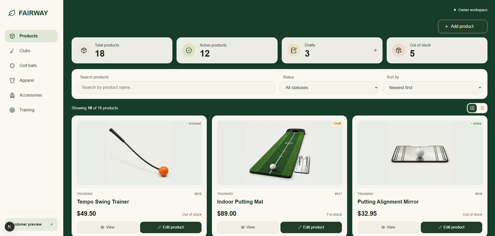 | 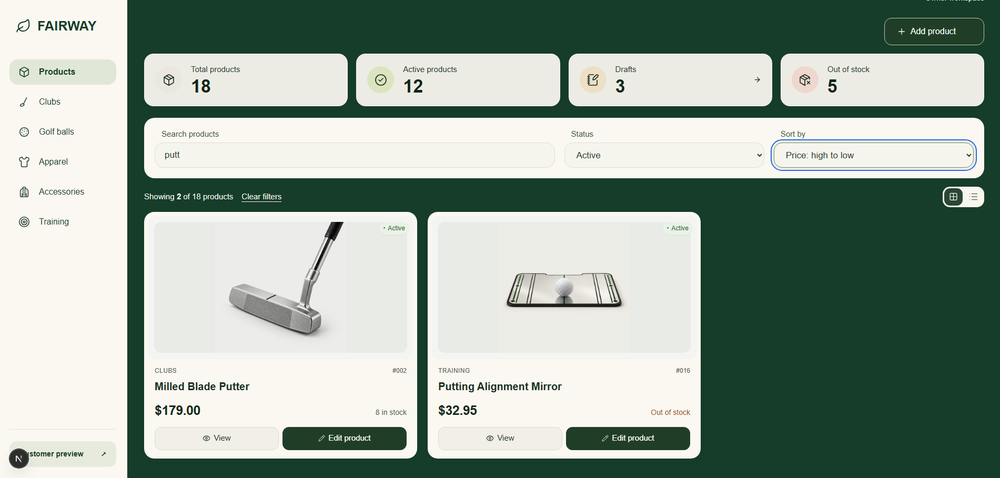 |
| Inventory metrics, category navigation and product controls | Search, category, status and price sorting working together |

| Table view | Add product |
| --- | --- |
| 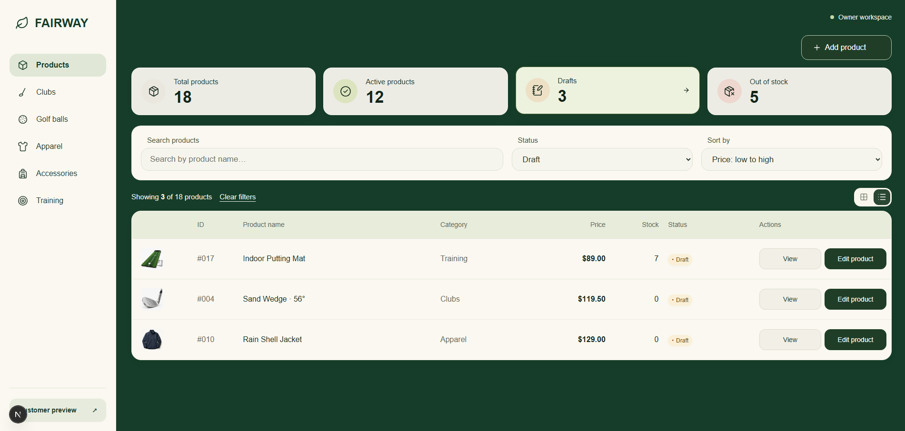 | 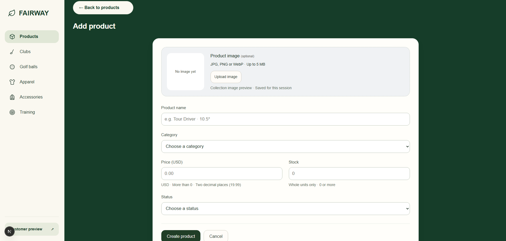 |
| Compact inventory view with clear status and actions | Labelled inputs, image upload and clear form actions |

| Product details and actions | Customer preview |
| --- | --- |
| 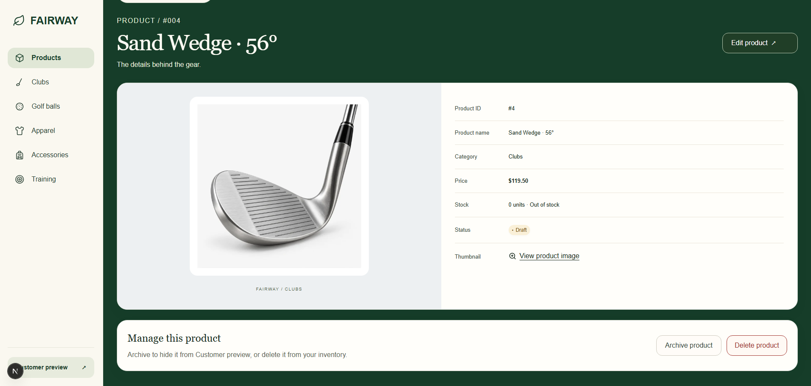 | 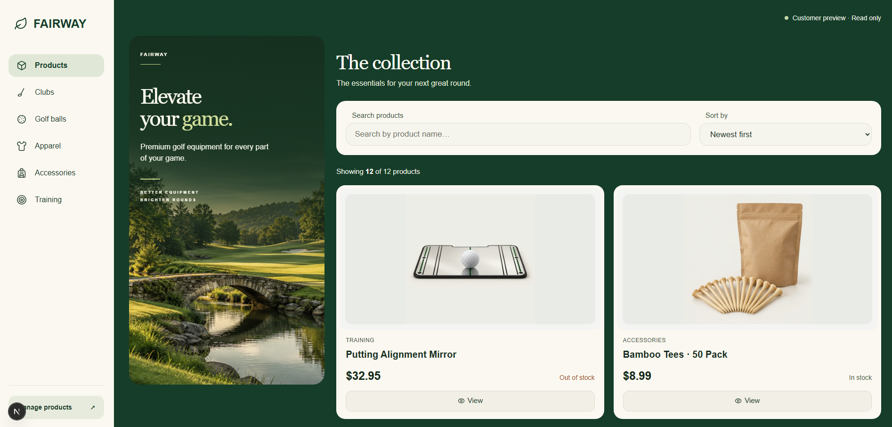 |
| Complete product record with edit, archive and delete controls | Read-only customer catalog with its own responsive controls |

### Mobile

The following screenshots were captured in a mobile browser against the local production-style preview.

| Owner workspace | Product actions |
| --- | --- |
| 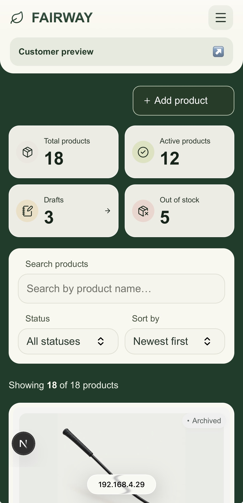 | 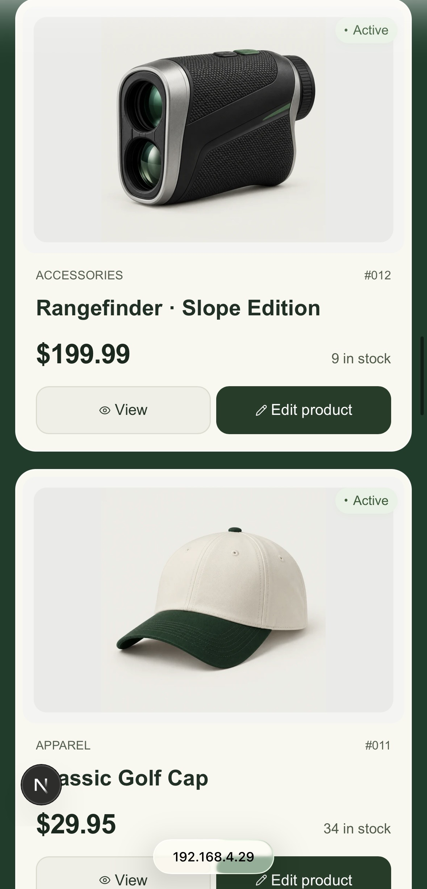 |
| Inventory overview and responsive controls | Product photos, stock, status and aligned actions |

| Combined filters | Validation feedback |
| --- | --- |
| 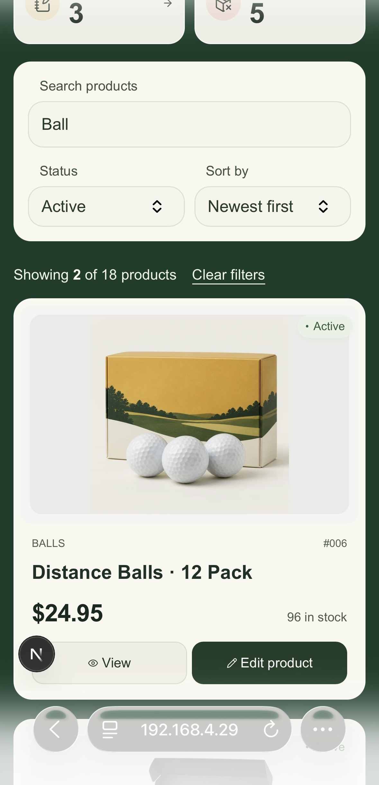 | 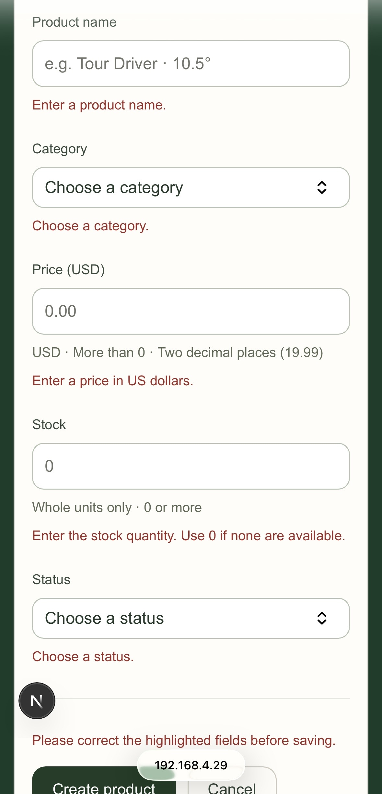 |
| Case-insensitive search and status filtering working together | Clear field-level errors and submission guidance |

| Image preview | Customer preview |
| --- | --- |
| 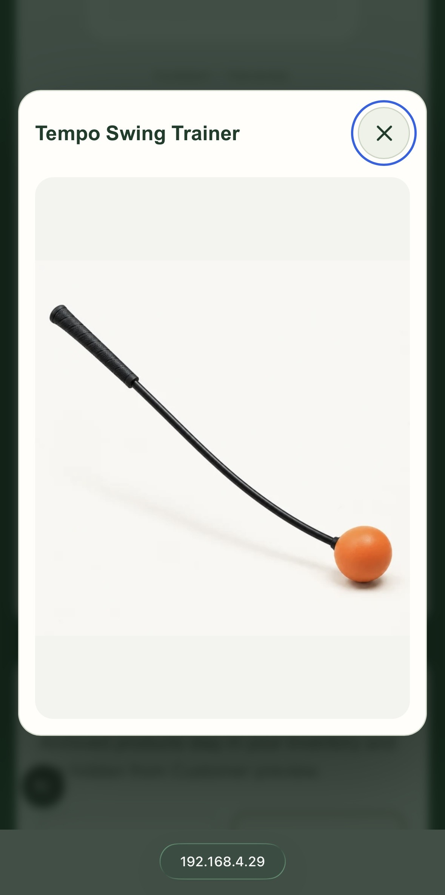 | 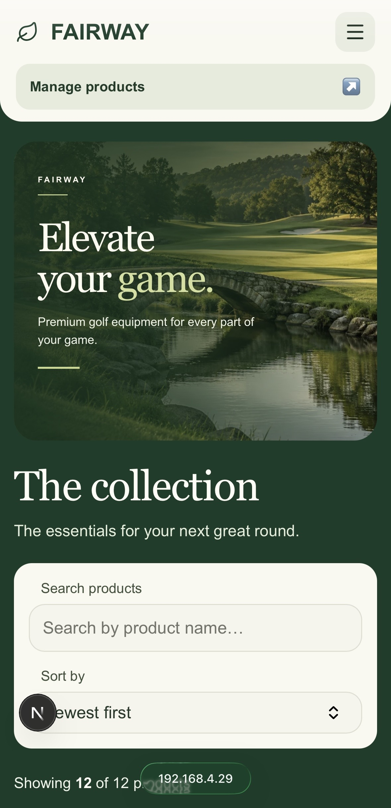 |
| In-page enlargement without leaving the application | Read-only catalog with responsive search and sorting |

| Out-of-stock customer item |
| --- |
| 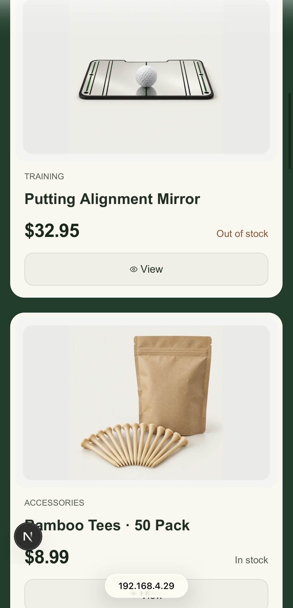 |
| Active zero-stock inventory remains visible and is clearly labelled |

## Implementation

See [IMPLEMENTATION.md](IMPLEMENTATION.md) for architecture, validation, dependencies, tradeoffs, verification and contributions.

